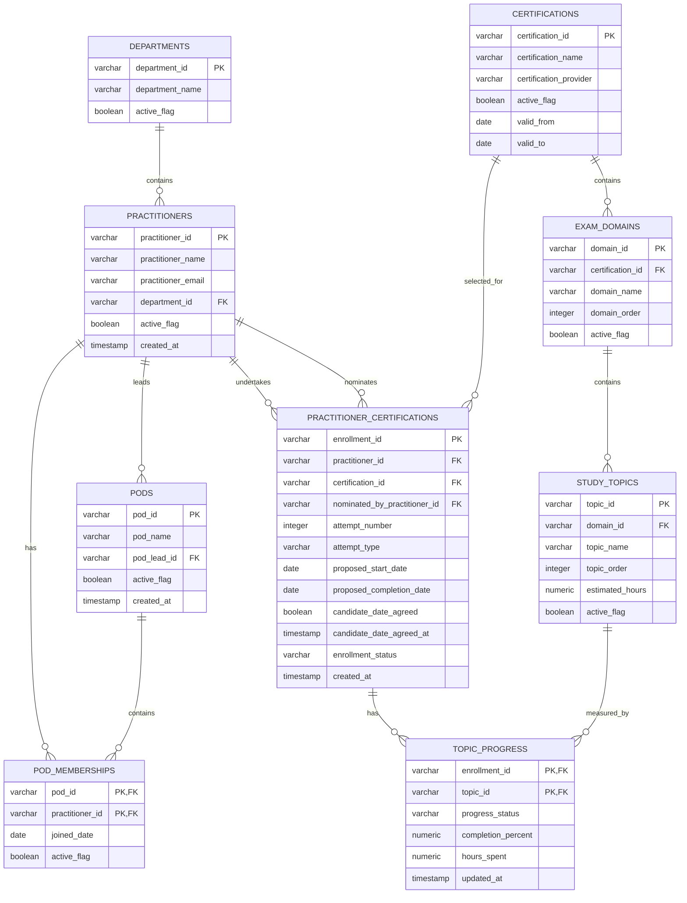

# Snowflake Certification Enablement Platform

## Data Model, ER Diagram and Normalization: Learning Notes

---

## 1. Purpose

This document records a data-modelling practice exercise. It was done in a local PostgreSQL database with fictional sample data. pgAdmin was used to run SQL and generate the ER diagram.

The goals were to:

- Decide which tables the platform needs.
- Connect the tables with primary keys and foreign keys.
- Read and generate an ER diagram.
- Understand one-to-many and many-to-many relationships.
- Understand why normalization is needed (1NF, 2NF, 3NF).
- Store whether a candidate agreed to a proposed date.

> **Status: proposed model, not deployed.**
> This PostgreSQL model is a learning and design proposal.
> It has **not** replaced the existing Snowflake `CORE` tables.
> Architecture review and approval are needed before any change in Snowflake.

---

## 2. Why this exercise was done

An architecture review gave this feedback:

- Keep practitioner data in its own table.
- Keep certification data in its own table.
- Link each topic to a certification.
- Use a connecting table to record who takes which certification.
- Store dates, status and attempt details in the connecting table, not in the practitioner table.
- Do not repeat practitioner data each time the person takes another certification.
- Support more certifications than SnowPro Core.
- Support repeat attempts and renewals.
- Document assumptions.
- Keep the documentation in Markdown and Git.

The scope was then narrowed to:

- The data model.
- Markdown documentation.
- Assumptions.
- Current version versus roadmap.
- Weighted topic allocation kept for a future version.

---

## 3. The fictional example used in this document

| ID | What it is |
| --- | --- |
| `DEP001` | Data Engineering (department) |
| `EMP001` | Amritha (practitioner and candidate) |
| `EMP002` | Thiyagarajan (practitioner, Pod Lead and nominator) |
| `POD001` | Data Engineering Pod |
| `CERT001` | SnowPro Core (certification) |
| `DOM001` | Snowflake Architecture (exam domain) |
| `TOP001` | Snowflake Architecture Overview (study topic) |
| `ENR001` | Amritha's SnowPro Core enrollment |

The story:

1. Amritha and Thiyagarajan are in the Data Engineering department.
2. Thiyagarajan leads the Data Engineering Pod.
3. Amritha is a member of the Data Engineering Pod.
4. Thiyagarajan nominates Amritha for SnowPro Core.
5. A proposed start date and completion date are recorded.
6. Amritha agrees to the proposed date.
7. SnowPro Core has exam domains. Each domain has study topics.
8. Amritha's progress is stored separately for each topic.

---

## 4. The nine tables

| # | Table | What it stores | Primary key |
| --- | --- | --- | --- |
| 1 | `departments` | Each department, once | `department_id` |
| 2 | `practitioners` | Every person in the process, once | `practitioner_id` |
| 3 | `pods` | Each Pod and its lead | `pod_id` |
| 4 | `pod_memberships` | Which practitioner is in which Pod | `pod_id` + `practitioner_id` |
| 5 | `certifications` | Each supported certification | `certification_id` |
| 6 | `exam_domains` | The domains inside a certification | `domain_id` |
| 7 | `study_topics` | The topics inside a domain | `topic_id` |
| 8 | `practitioner_certifications` | One practitioner's enrollment or attempt for one certification | `enrollment_id` |
| 9 | `topic_progress` | Progress for one enrollment and one topic | `enrollment_id` + `topic_id` |

### The three business areas

This grouping is only to make the model easier to explain. All nine tables belong to one model.

| Area | Tables |
| --- | --- |
| People and Pods | `departments`, `practitioners`, `pods`, `pod_memberships` |
| Certification content | `certifications`, `exam_domains`, `study_topics` |
| Enrollment and progress | `practitioner_certifications`, `topic_progress` |

### Sample row counts (confirmed in PostgreSQL)

| Table | Rows |
| --- | --- |
| `departments` | 2 |
| `practitioners` | 3 |
| `pods` | 1 |
| `pod_memberships` | 2 |
| `certifications` | 2 |
| `exam_domains` | 4 |
| `study_topics` | 6 |
| `practitioner_certifications` | 3 |
| `topic_progress` | 9 |

---

## 5. What each table does

### `departments`

- Stores each department once.
- Columns: `department_id` (PK), `department_name`, `active_flag`.
- Example: `DEP001` = Data Engineering.

### `practitioners`

- Stores every person involved. One person can be a candidate, Pod member, Pod Lead or nominator.
- Columns: `practitioner_id` (PK), `practitioner_name`, `practitioner_email`, `department_id` (FK), `active_flag`, `created_at`.
- Examples: `EMP001` = Amritha, `EMP002` = Thiyagarajan.

### `pods`

- Stores each Pod and who leads it.
- Columns: `pod_id` (PK), `pod_name`, `pod_lead_id` (FK to `practitioners`), `active_flag`, `created_at`.
- Example: `POD001` has `pod_lead_id` = `EMP002`. So Thiyagarajan leads it.

### `pod_memberships`

- Connects practitioners to Pods.
- Columns: `pod_id` (FK), `practitioner_id` (FK), `joined_date`, `active_flag`.
- Primary key: `pod_id` + `practitioner_id` together.
- Example: `POD001` + `EMP001` means Amritha is in the Data Engineering Pod.

### `certifications`

- Stores each supported certification.
- Columns: `certification_id` (PK), `certification_name`, `certification_provider`, `active_flag`, `valid_from`, `valid_to`.
- Example: `CERT001` = SnowPro Core, provider = Snowflake.
- The model uses its own internal ID. This avoids depending on an official certification code that may change later.

### `exam_domains`

- Stores the main subject areas of a certification.
- Columns: `domain_id` (PK), `certification_id` (FK), `domain_name`, `domain_order`, `active_flag`.
- Example: `DOM001` = Snowflake Architecture. It belongs to `CERT001`.

### `study_topics`

- Stores the study topics inside each domain.
- Columns: `topic_id` (PK), `domain_id` (FK), `topic_name`, `topic_order`, `estimated_hours`, `active_flag`.
- Example: `TOP001` = Snowflake Architecture Overview. It belongs to `DOM001`.
- This table has no `certification_id` column. The certification is found by following the keys:

```text
study_topics.domain_id
  -> exam_domains.domain_id
  -> exam_domains.certification_id
  -> certifications.certification_id
```

Example: `TOP001` -> `DOM001` -> `CERT001`.

### `practitioner_certifications`

- Stores one practitioner's enrollment (attempt) for one certification.
- Columns:
  - `enrollment_id` (PK)
  - `practitioner_id` (FK): the candidate
  - `certification_id` (FK)
  - `nominated_by_practitioner_id` (FK): the nominator
  - `attempt_number`
  - `attempt_type`: for example `FRESH` or `RENEWAL`
  - `proposed_start_date`
  - `proposed_completion_date`
  - `candidate_date_agreed`
  - `candidate_date_agreed_at`
  - `enrollment_status`
  - `created_at`
- Example: `ENR001` links Amritha (`EMP001`) to SnowPro Core (`CERT001`). The nominator is Thiyagarajan (`EMP002`).
- This table is needed because:
  - One practitioner can take many certifications.
  - One certification can be taken by many practitioners.
- Every attempt gets its own row. This supports repeat attempts and renewals.

### `topic_progress`

- Stores the current progress for one enrollment and one topic.
- Columns: `enrollment_id` (FK), `topic_id` (FK), `progress_status`, `completion_percent`, `hours_spent`, `updated_at`.
- Primary key: `enrollment_id` + `topic_id` together.
- Examples:
  - `ENR001` + `TOP001` at 100%: Amritha finished `TOP001`.
  - `ENR001` + `TOP002` at 50%: Amritha is halfway through `TOP002`.
- It stores the current state only. It is not a full activity history.

---

## 6. ER diagram

This diagram is drawn from the table design above. The diagram generated in pgAdmin is the physical version of the same model.



> **Note:** The diagram above does not mark unique constraints (UK). Which columns have unique constraints in the PostgreSQL database is still to be confirmed. See section 15.

---

## 7. How to read an ER diagram

An ER diagram (Entity Relationship Diagram) shows:

- **Entities:** the business objects. Each one is a table.
- **Attributes:** the data stored about an entity. Each one is a column.
- **Primary keys (PK):** columns that identify each row uniquely.
- **Foreign keys (FK):** columns that point to a row in another table.
- **Relationships:** lines between tables.

### Reading the line ends

Each end of a relationship line shows how many rows can be on that side.

**Mermaid symbols used in this document:**

- `||` means exactly one.
- `o|` or `|o` means zero or one.
- `|{` or `}|` means one or many.
- `o{` or `}o` means zero or many.

**Example:**

```text
DEPARTMENTS ||--o{ PRACTITIONERS
```

Read it from left to right:

- `||` on the department side: one department.
- `o{` on the practitioner side: zero, one or many practitioners.

In plain words: one department can have many practitioners. Each practitioner belongs to one department.

### Reading the pgAdmin ER diagram

pgAdmin draws the ends differently from Mermaid.

- The end with a **single line** is the "one" side. It is the table that is referenced.
- The end with **three lines (crow's foot)** is the "many" side. It is the table that holds the foreign key.
- Small circles on the lines may only be connection or editing handles. Do not read them as "optional".

> **Important:** Whether a column is required or optional depends on whether it allows `NULL`. This has not been checked yet. So this document does not claim which relationships are mandatory or optional. See section 15.

---

## 8. Relationships

### The eleven foreign keys

These were confirmed with a PostgreSQL metadata query.

| # | Child table and column | Parent table and column |
| --- | --- | --- |
| 1 | `practitioners.department_id` | `departments.department_id` |
| 2 | `pods.pod_lead_id` | `practitioners.practitioner_id` |
| 3 | `pod_memberships.pod_id` | `pods.pod_id` |
| 4 | `pod_memberships.practitioner_id` | `practitioners.practitioner_id` |
| 5 | `exam_domains.certification_id` | `certifications.certification_id` |
| 6 | `study_topics.domain_id` | `exam_domains.domain_id` |
| 7 | `practitioner_certifications.practitioner_id` | `practitioners.practitioner_id` |
| 8 | `practitioner_certifications.certification_id` | `certifications.certification_id` |
| 9 | `practitioner_certifications.nominated_by_practitioner_id` | `practitioners.practitioner_id` |
| 10 | `topic_progress.enrollment_id` | `practitioner_certifications.enrollment_id` |
| 11 | `topic_progress.topic_id` | `study_topics.topic_id` |

The child table holds the foreign key. The parent table holds the primary key it points to.

### Relationship explanations

**Department to practitioner (one-to-many)**

- One department has many practitioners.
- Each practitioner has one department in this version.
- Link: `practitioners.department_id`.

**Practitioner to Pod as lead (one-to-many)**

- One practitioner can lead many Pods.
- Each Pod has one lead in this version.
- Link: `pods.pod_lead_id`.

**Practitioners and Pods as members (many-to-many)**

- One practitioner can be in many Pods.
- One Pod can have many practitioners.
- A many-to-many relationship needs a connecting table. Here it is `pod_memberships`.
- The pair `pod_id` + `practitioner_id` must be unique. The same practitioner cannot be added to the same Pod twice.

**Practitioners and certifications (many-to-many)**

- One practitioner can take many certifications.
- One certification can be taken by many practitioners.
- The connecting table is `practitioner_certifications`.
- This table holds data that belongs to the pair, such as dates, attempt number and agreement.

**Two links to `practitioners` from one table**

`practitioner_certifications` points to `practitioners` twice. This is intentional.

- `practitioner_id` = the candidate (Amritha).
- `nominated_by_practitioner_id` = the nominator (Thiyagarajan).

**Certification to domain, and domain to topic (one-to-many)**

- One certification has many domains.
- One domain has many topics.
- A topic reaches its certification through its domain.

**Enrollment and topics (many-to-many)**

- One enrollment has progress for many topics.
- One topic can have progress rows for many enrollments.
- The connecting table is `topic_progress`.
- The pair `enrollment_id` + `topic_id` is unique. One enrollment has only one current progress row per topic.

---

## 9. Complete example path

This follows the fictional data through the model.

| Step | What happens | Table |
| --- | --- | --- |
| 1 | Data Engineering is stored as `DEP001` | `departments` |
| 2 | Amritha is stored as `EMP001` | `practitioners` |
| 3 | Thiyagarajan is stored as `EMP002` | `practitioners` |
| 4 | Both rows point to `DEP001` through `department_id` | `practitioners` |
| 5 | The Data Engineering Pod is stored as `POD001` | `pods` |
| 6 | `pod_lead_id` = `EMP002`, so Thiyagarajan leads the Pod | `pods` |
| 7 | `POD001` + `EMP001` makes Amritha a member | `pod_memberships` |
| 8 | SnowPro Core is stored as `CERT001` | `certifications` |
| 9 | Its domains are stored, for example `DOM001` | `exam_domains` |
| 10 | Each domain's topics are stored, for example `TOP001` | `study_topics` |
| 11 | `ENR001` links Amritha (`EMP001`) to SnowPro Core (`CERT001`) | `practitioner_certifications` |
| 12 | `nominated_by_practitioner_id` = `EMP002` | `practitioner_certifications` |
| 13 | `ENR001` stores dates, attempt details, status and agreement | `practitioner_certifications` |
| 14 | `ENR001` + `TOP001` stores the current progress | `topic_progress` |

### Questions the model can answer

- Which certifications is Amritha taking?
- Which topics belong to SnowPro Core?
- What is Amritha's progress on each topic?
- Which Pod is Amritha in?
- Who nominated Amritha?
- Has Amritha agreed to the proposed date?

### Example query (illustrative)

This query shows Amritha's progress on each SnowPro Core topic. It follows the foreign keys from section 8.

```sql
SELECT
    p.practitioner_name,
    c.certification_name,
    d.domain_name,
    t.topic_name,
    tp.progress_status,
    tp.completion_percent
FROM topic_progress tp
JOIN practitioner_certifications pc ON pc.enrollment_id = tp.enrollment_id
JOIN practitioners p                ON p.practitioner_id = pc.practitioner_id
JOIN certifications c               ON c.certification_id = pc.certification_id
JOIN study_topics t                 ON t.topic_id = tp.topic_id
JOIN exam_domains d                 ON d.domain_id = t.domain_id
WHERE pc.enrollment_id = 'ENR001';
```

---

## 10. Candidate agreement to the proposed date

This was an explicit requirement. The agreement is stored in separate columns.

Two columns in `practitioner_certifications`:

| Column | Type | Purpose |
| --- | --- | --- |
| `candidate_date_agreed` | Boolean | Whether the candidate accepted the proposed date |
| `candidate_date_agreed_at` | Timestamp | When the candidate accepted it |

**Intended meaning:**

| `candidate_date_agreed` | Meaning |
| --- | --- |
| `TRUE` | The candidate accepted the proposed date |
| `FALSE` | The candidate has not accepted the proposed date |

- `candidate_date_agreed_at` should normally stay empty until the candidate agrees.

**Why these columns are in `practitioner_certifications`:**

- The agreement is about one candidate and one certification attempt.
- It is not about the practitioner in general.
- It is not about the certification in general.
- If Amritha takes another certification later, that attempt gets its own agreement.

> **Not confirmed:** This is the *intended* rule. It has not been verified that a database constraint enforces it. For example, nothing has been confirmed that stops `candidate_date_agreed` = `TRUE` with an empty timestamp. Check the current constraint definition before claiming it is enforced.

---

## 11. Why normalization is needed

Normalization means splitting data into related tables. Each fact is stored in one place.

**Problems with one large table:**

| Practitioner | Department | Pod | Certification | Topic | Progress |
| --- | --- | --- | --- | --- | --- |
| Amritha | Data Engineering | Data Engineering Pod | SnowPro Core | Topic A | 100% |
| Amritha | Data Engineering | Data Engineering Pod | SnowPro Core | Topic B | 50% |

- Name, department, Pod and certification repeat on every row.
- If the department name changes, many rows must be updated. Missing one row leaves inconsistent data.
- Adding a new certification needs a new row with practitioner data attached.

**Benefits of normalization:**

- Less repeated data.
- More consistent values.
- Safer updates.
- Clear relationships.
- Easier to add more practitioners and certifications.

---

## 12. The normalization exercise

The practice used these tables. They are practice tables only. They are **not** in the final ER diagram.

| Step | Table(s) | Rows |
| --- | --- | --- |
| Unnormalized | `practitioner_certification_unnormalized` | 3 |
| 1NF | `practitioner_certification_1nf` | 9 |
| 2NF | `practitioners_2nf`, `certifications_2nf`, `certification_topics_2nf`, `practitioner_certifications_2nf` | 2, 2, 6, 3 |
| 3NF (final) | The nine tables in section 4 | See section 4 |

### Unnormalized table

One table held everything: practitioner, department, Pod, Pod Lead, certification, dates, agreement, nomination status and a comma-separated list of topics.

Records used:

- Amritha nominated for SnowPro Core.
- Ananya nominated for SnowPro Core.
- Amritha nominated for SnowPro Gen AI.

**Problem:** Different subjects were mixed together. Topics were stored as a list in one column.

### First Normal Form (1NF)

**Rule:**

- Each column holds one value.
- No lists inside a column.
- Each row can be identified uniquely.

**Before (not 1NF):**

| Practitioner | Topics |
| --- | --- |
| Amritha | Topic A, Topic B, Topic C |

**After (1NF):**

| Practitioner | Topic |
| --- | --- |
| Amritha | Topic A |
| Amritha | Topic B |
| Amritha | Topic C |

- PostgreSQL's `REGEXP_SPLIT_TO_TABLE` split the list into rows.
- Three nominations with three topics each gave nine rows.

**Remaining problem:** Practitioner, Pod and certification details still repeat on every topic row.

### Second Normal Form (2NF)

**Rule:**

- The table is already in 1NF.
- Every non-key column depends on the whole primary key, not on part of it.

**What was split:**

- Practitioner name and email depend only on the practitioner.
- Certification name depends only on the certification.
- Proposed dates and agreement depend on the practitioner + certification pair.
- Topic data depends on the certification + topic pair.

**Remaining problem:** Pod and Pod Lead details were still mixed with practitioner details.

### Third Normal Form (3NF)

**Rule:**

- The table is already in 2NF.
- A non-key column must not depend on another non-key column.

**Example of the problem:**

```text
practitioner_id, practitioner_name, department_id, department_name
```

`department_name` depends on `department_id`, not on `practitioner_id`. So department data moves to its own table:

```text
departments:   department_id, department_name
practitioners: practitioner_id, practitioner_name, department_id (FK)
```

The same idea was applied to Pods, certifications, domains, topics and progress. This gave the final nine tables.

### Summary

| Normal form | Rule | Example in this model |
| --- | --- | --- |
| 1NF | One value per column | One topic per row, not a list |
| 2NF | Data depends on the whole key | Topic name is in `study_topics`, not in `topic_progress` |
| 3NF | Data does not depend on other non-key data | Department name is in `departments`, not in `practitioners` |

---

## 13. Keys and constraints

### Primary key

A primary key identifies each row uniquely.

- `departments.department_id`
- `practitioners.practitioner_id`
- `certifications.certification_id`
- `practitioner_certifications.enrollment_id`

### Foreign key

A foreign key stores the ID of a row in another table. It creates the relationship. The database rejects a foreign-key value that does not exist in the parent table.

- `practitioners.department_id` refers to `departments.department_id`.

### Composite primary key

A composite primary key uses two columns together. The pair must be unique. Each column alone can repeat.

- `pod_memberships`: `pod_id` + `practitioner_id`
- `topic_progress`: `enrollment_id` + `topic_id`

### Unique constraint

A unique constraint stops duplicate values in a column or a group of columns.

> In the pgAdmin diagram, a blue "1" icon on a column shows a unique constraint. Which exact column combination each one covers has not been checked. See section 15.

---

## 14. Assumptions and current limits

**Assumptions in this version:**

- The data is fictional.
- A practitioner belongs to one department at a time.
- A practitioner can be in many Pods through `pod_memberships`.
- Each Pod has one lead.
- A practitioner can have many certification attempts.
- `attempt_number` and `attempt_type` separate repeat attempts and renewals.
- A certification has domains. A domain has topics.
- `topic_progress` stores current progress only, not a full history.

**Limits:**

- This is a PostgreSQL practice model. It is not the Snowflake physical model.
- The ER diagram shows data structure only. It does not show:
  - CSV upload
  - RAW tables
  - Streams and Tasks
  - Stored procedures
  - Validation flow
  - Reminder emails
  - Analytics views

  Those belong in an architecture or workflow diagram.

---

## 15. Open points to confirm

These are not verified. Do not state them as facts until they are checked.

| # | Open point | How to check |
| --- | --- | --- |
| 1 | Is the rule for `candidate_date_agreed` and `candidate_date_agreed_at` enforced by a constraint? | Check the constraint definitions on `practitioner_certifications` |
| 2 | Should `candidate_date_agreed` use `NULL` for "no response", and `FALSE` for "declined"? Or does `FALSE` mean "not accepted"? | Business decision |
| 3 | Which columns are required (`NOT NULL`) and which are optional? | Check column nullability in PostgreSQL |
| 4 | Which column combinations do the blue "1" unique icons cover? | Check the unique constraint definitions |
| 5 | Are `department_name`, `practitioner_email`, `pod_name` and `certification_name` unique? | Check the unique constraint definitions |
| 6 | Do Pod membership and certification attempts need history dates? | Business decision |
| 7 | How should the approved model be adapted to Snowflake? | Architecture review |
| 8 | Should `PRACTITIONERS` be renamed to match the current `LEARNERS` name? | Architecture review |

---

## 16. Roadmap (not in the current nine-table model)

These are future extensions only:

- Weighted topic scheduling
- Extension approval and schedule recalculation
- Exam scheduling
- Pass or fail results
- Certification issue and expiry dates
- Expiry reminders
- Learning-resource management
- Partner-level certification targets
- Recommendation agents
- Interview feedback and employee write-ups

---

## 17. Key findings

1. A data model defines what is stored, where it is stored and how the data is related.
2. An ER diagram is the visual form of the model.
3. A many-to-many relationship needs a connecting table. Examples: `pod_memberships`, `practitioner_certifications`, `topic_progress`.
4. A topic reaches its certification through its exam domain.
5. Dates, attempt details and agreement belong in `practitioner_certifications`, not in `practitioners`.
6. Topic progress must be linked to both an enrollment and a topic.
7. Primary keys and foreign keys keep the relationships valid.
8. Normalization removes repeated data. Each fact is stored once.
9. The ER diagram should be generated from real database constraints.

---

## 18. What I learned

- How to find business entities from a use case and turn them into tables.
- How to choose primary keys and foreign keys.
- How to use a connecting table for a many-to-many relationship.
- How to read an ER diagram.
- How 1NF, 2NF and 3NF reduce repeated data.
- That the ER diagram should come from real, working constraints, not only from a drawing.
